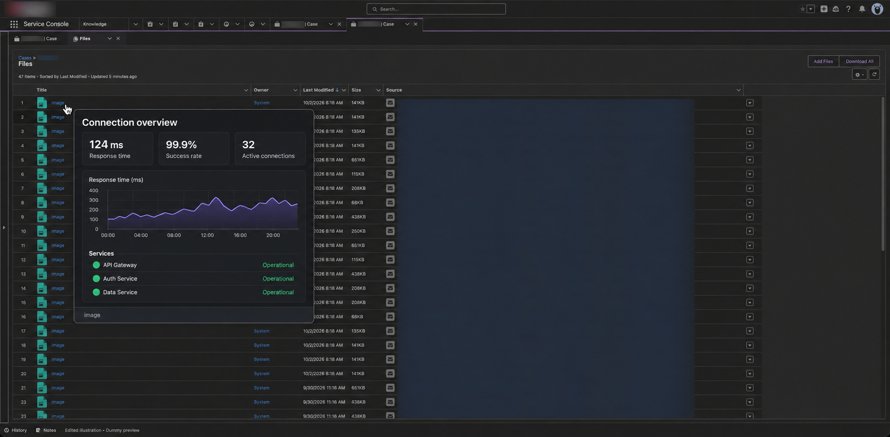
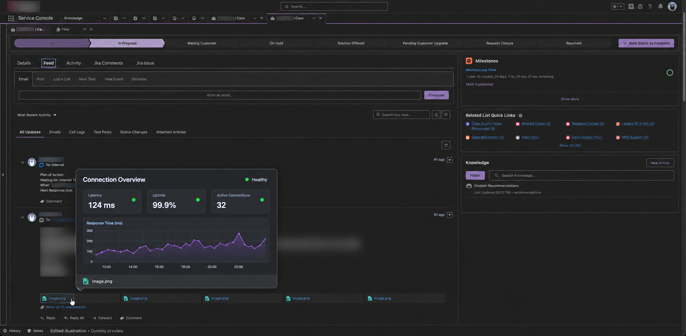

# QuickView for Salesforce

**See the attachment. Stay on the case.**

QuickView is a Chrome extension that adds a floating preview when you hover over a Salesforce file name. It is designed for the Files tab and related Files lists in Lightning, including the Service Console. Separately listed attachments under **Feed → Email** use the same hover preview.

**Version 0.0.3 · Document and text previews · Manifest V3**

The concept and original browser-console prototype came from [@jorgestocker](https://github.com/jorgestocker), who gave permission to develop the idea into an extension. This repository contains a new implementation; it does not include or derive from his original JavaScript.

## In action



*Cases → Files: based on the user-provided, pre-masked Salesforce screenshot. The company-logo, case-number, and Source masks are preserved. The added QuickView preview contains dummy data; this is an edited illustration.*



*Feed → Email: based on a user-provided Salesforce screenshot with existing privacy masks preserved. The added preview uses dummy data and appears above the attachment near the bottom of the viewport. This is an edited illustration; inline email-body images are excluded.*

---

## Get started

1. Download this repository, or extract the [release archive](dist/quickview-for-salesforce-0.0.3.zip) created by `npm run package`.
2. Open `chrome://extensions` in Chrome.
3. Enable **Developer mode** in the upper-right corner.
4. Click **Load unpacked** and select the **`extension/`** directory. If using the archive, select its extracted directory, which contains `manifest.json`.
5. Refresh your Salesforce tab. Open a case’s **Files** tab or **Files** related list, or an email’s attachment cards under **Feed**, and hover over a file name.
6. Pin QuickView in Chrome’s Extensions menu. Click its icon to open settings.

No Salesforce package, administrator installation, API token, or build step is required. Your existing Salesforce login supplies file access. Your organization may restrict browser extensions or file downloads.

## What it does

- Shows image, document, and text previews on hover without changing the file link’s click behavior.
- Supports keyboard focus on recognized file links. Press **Esc**, move away, scroll, or change focus to dismiss.
- Positions the preview near the pointer and keeps it within the viewport.
- Recognizes dynamically inserted rows and email attachment cards, including attachments revealed by **Show all attachments**.
- Temporarily removes native `title` tooltips from the hovered row, then restores them.
- Saves preferences locally and applies changes to open Salesforce tabs.

### Preview support

| File type | Hover preview |
| --- | --- |
| PNG, JPEG, GIF, WebP, BMP, AVIF | Original image or Salesforce thumbnail, preserving aspect ratio. |
| PPT/PPTX, DOC/DOCX, XLS/XLSX, PDF | Salesforce-generated first-page thumbnail: the opening slide, page, or rendered sheet area. Requires an accessible version reference or existing rendition URL and a generated Salesforce preview. |
| RTF, ODT, ODS, ODP | Attempts the same Salesforce thumbnail route; rendition availability varies. |
| CSV | Table excerpt: up to 21 rows including headings, 10 columns, and 500 characters per cell. Quoted fields and embedded newlines are handled. Formulas remain literal text. |
| JSON | Formatted JSON excerpt; invalid or incomplete JSON is shown as raw text. |
| TXT, LOG, MD, XML, YAML/YML | Plain text excerpt. Markup and scripts are displayed as text. |
| ZIP and other archives | No preview or file download. Normal clicks still work. |
| SVG, video, audio, unknown types | No original-file renderer. An available Salesforce image rendition can still be displayed. |
| Legacy `Attachment` records (`00P…`) | Image and recognized text previews use the legacy download route. Office files require a Salesforce rendition and cannot be rendered from legacy Office binaries. |

Office previews are quick visual references, not full document viewers or editable spreadsheets. Click the filename to open Salesforce’s viewer for more pages, sheets, or slides. Salesforce can delay or fail rendition generation and may simplify formatting; see its [supported preview formats](https://help.salesforce.com/s/articleView?id=005227030&language=en_US&type=1) and [preview limitations](https://help.salesforce.com/s/articleView?id=000337845&language=en_US&type=1).

Text previews read at most **256 KiB** of UTF-8 content, then cancel the stream. Text excerpts are limited to 200 lines / 20,000 characters; notices identify truncation. The hover card does not scroll or accept clicks. Leaving the file aborts pending text requests. Content is rendered locally with `textContent`, never executed, uploaded, or saved to extension storage.

**Live-org status:** Files-tab image previews, separately listed Feed → Email image attachments, and PowerPoint hover previews have been confirmed working in the project owner’s Salesforce Lightning org. Other Office formats and text previews pass fixture tests and still need live-org confirmation. Automated checks cover local fixtures, including the observed Aura attachment structure. Lightning markup varies between releases and org configurations; previews require a file reference in a recognized link, DOM attribute, accessible Aura attachment metadata, or the authenticated UI record API.

Salesforce’s Shepherd rendition URLs are **internal, unsupported endpoints** and may change. Salesforce also documents cross-domain authentication limitations for them. See [Salesforce’s guidance on internal rendition URLs](https://help.salesforce.com/s/articleView?id=005227037&language=en_US&type=1). QuickView uses these preview routes because private case attachments are not public CMS assets. It does not bypass permissions or create public sharing links.

Image previews first request the **full original image**, so large images consume bandwidth and browser memory. Files are loaded only after the hover delay; there is no prefetching. Images are not copied into extension storage. Salesforce response caching follows the browser’s normal rules.

### Feed → Email attachments

Hover or keyboard-focus the name of a separately listed attachment. QuickView recognizes file links, attachment buttons, and IDs on the individual card. Each attachment is resolved independently; cards with missing metadata do not use a neighboring file’s ID. Normal attachment clicks and **Show all attachments** behavior are preserved.

Modern Files (`069…` / `068…`) follow the preview rules above, including Office and text formats. Older image attachments (`00P…`) use Salesforce’s file-download route. Inline body images do not activate a preview. Aura email tiles that expose only a filename and `data-index` use a read-only component adapter. It supports Feed capability attachment lists and Aura iteration entries where the wrapper contains `fileName` and the nested `attachment` contains the file ID. It checks the indexed attachment’s filename before accepting its file ID. If Salesforce restricts component access or uses an unsupported metadata shape, the card shows “Attachment reference unavailable”; it never guesses a neighboring attachment.

## Settings

Open the extension’s toolbar icon, or choose **Extension options** from its menu.

| Setting | Default | Available values |
| --- | --- | --- |
| Hover previews | On | On / off |
| Theme | System | System / Light / Dark |
| Preview size | 100% | 50–500%; 100% = 520 × 380 px in a 2560 × 1258 px window |
| Hover delay | 250 ms | 0–5,000 ms |
| Dialog hover delay | 1,000 ms | 0–5,000 ms; overrides general delay in dialogs |
| Previews in dialogs | On | Disable to keep file pickers clear |
| Preview animation | None | None / Fade in–out / Fall in / Scale up / Scale down |
| Corner radius | 12 px | 0–32 px |
| Border width | 1 px | 0–6 px |
| Border color | `#D5DBE7` | Any RGB color |
| Soft shadow | On | On / off |
| Show file name | On | On / off |
| Hide browser tooltips | On | On / off |

Animations are off by default. Fade, fall-in, and scale options animate both arrival and dismissal. Use **Replay animation** in settings to try the selected effect. The system’s reduced-motion preference disables these effects.

Settings save automatically. **Restore defaults** resets every preference. System theme follows your operating system. The live sample uses selectable masked Salesforce Files and Feed screenshots with an interactive dummy preview layered above them. These background assets are bundled locally. The sample uses the original 2560 px screenshot viewport as its reference and scales the entire card, including its text, padding, and borders; live previews use those same proportions relative to both window dimensions and shrink together to fit available space. Existing width/height preferences are converted to a percentage. Images preserve their aspect ratio and are never cropped.

Tooltip suppression applies to native browser `title` attributes. Salesforce-created popovers are separate UI elements and may still appear. Accessible labels and file clicks remain intact.

## Privacy & permissions

QuickView has no analytics, remote scripts, telemetry, backend, or third-party file uploads.

- **`storage`** stores preferences in `chrome.storage.local`, not synced storage.
- **Content script access** is limited to HTTPS Lightning (`*.lightning.force.com`), My Domain (`*.my.salesforce.com`), and `*.salesforce.mil` pages. It reads rendered file links and metadata, loads authenticated images/renditions or bounded text excerpts, and displays the preview.
- File requests go to Salesforce using your current browser session. The extension does not read cookies, access tokens, or Salesforce API credentials.
- It does not store file contents, names, or record IDs. No background file processing is performed.

The preview runs in Chrome’s [isolated content-script environment](https://developer.chrome.com/docs/extensions/develop/concepts/content-scripts). A small bundled adapter runs in the page world to read attachment metadata from the hovered Aura email component using Salesforce’s [component value-provider methods](https://github.com/forcedotcom/aura/blob/master/aura-impl/src/main/resources/aura/component/Component.js). The adapter also resolves document versions from matching Files-row metadata. When the row has no version reference, it requests only `ContentDocument.LatestPublishedVersionId` from Salesforce’s [UI record API](https://developer.salesforce.com/blogs/2018/01/introduction-salesforce-ui-api), checks that the response belongs to the hovered document, and uses its version ID to load the first-page thumbnail. Requests use the existing same-origin browser session; QuickView does not read or replay session tokens. Only validated file identifiers cross into the preview script; email contents and component objects are not copied or saved. Preview styles live in a shadow root to avoid interfering with Salesforce styles. No Salesforce JavaScript is patched or intercepted. Record metadata access and rendition downloads remain subject to Salesforce permissions and org policies.

Custom Experience Cloud domains, Classic Visualforce file lists, closed shadow DOM components, and non-matching Salesforce hostnames are outside this release’s scope. A matching hostname does not guarantee compatible file markup.

## Try it locally

Requires Node.js 20+ and Python 3 for packaging or rebuilding icons.

```sh
npm install
npm run demo
```

Visit:

- `http://127.0.0.1:4173/` — Files and Feed email demo, including failed previews, unsupported files, dynamic rows, and attachment expansion.
- `http://127.0.0.1:4173/extension/settings.html` — Settings design with working local preferences.

The demo serves a sample illustration for Salesforce file URLs. It does not contact Salesforce. Its storage adapter is excluded from the extension package, and the extension manifest does not grant localhost access.

## Development & verification

```sh
npm test
npx playwright install chromium
npm run test:browser
npm run test:extension
npm run package
```

To use an installed Chrome executable for browser checks:

```sh
CHROME_PATH='/Applications/Google Chrome.app/Contents/MacOS/Google Chrome' npm run test:browser
```

The unit suite checks settings validation, file-ID parsing, safe preview URL selection, and manifest assets. The browser suite checks hover and focus behavior, tooltip restoration, failed loads, unsupported files, inserted/removed rows, stale requests, viewport placement, preferences, themes, and narrow layouts. It also checks Feed attachment cards, keyboard access, click preservation, expansion, legacy images, missing metadata, and inline-image exclusion. Document and text checks also cover Office type detection, version matching, archive exclusion, quoted CSV fields, inert markup, JSON formatting, and bounded reads. It writes settings screenshots to `test-results/`.

Recreate the local demo screenshots with `npm run screenshots` (or set `CHROME_PATH` as above). This captures the actual hover preview against fictional fixture data and writes PNGs to `docs/images/`. The edited Salesforce Files and Feed illustrations are separate curated assets and are not regenerated by this command.

The browser suite injects the production scripts into a fixture using a demo storage adapter. A separate `test:extension` smoke check loads the unpacked extension in Playwright Chromium, verifies real extension storage and options-page assets, and exercises manifest injection on locally fulfilled Salesforce-host fixture routes, including nested Aura attachment references, filename/index matching, and masked diagnostics; the automated tests do not contact a Salesforce org. Manual testing in the project owner’s org confirmed Files-tab and Feed email image previews. Office and text formats added in 0.0.2 and other org configurations still need live-org validation.

`npm run package` creates `dist/quickview-for-salesforce-0.0.3.zip` containing only extension runtime files, ready to extract and load unpacked. It is not a signed Chrome Web Store package. Rebuild icon assets with `python3 scripts/icons.py`.

### Repository layout

```text
extension/     Manifest, content script, settings, toolbar action, bundled assets
demo/          Local Salesforce-style fixture and sample dashboard illustration
tests/         Unit checks and Playwright interaction checks
scripts/       Local server, reproducible packaging, icon renderer
docs/images/   README screenshots
```

## Troubleshooting

**No preview appears:** Confirm previews are enabled, reload the Salesforce page after installing/reloading the extension, and check that the file link is on a supported hostname. Hover the title, rather than the row background. Unsupported markup or a file link with no discoverable ID will not activate QuickView.

**“Attachment reference unavailable”:** QuickView recognized the Feed attachment tile but could not resolve its file ID from the component metadata. Use the diagnostic below to identify the available structure.

**“Preview unavailable” / “Text preview unavailable”:** QuickView resolved a reference but could not load a preview. The file may not have a rendition, its image type may not be discoverable, or your session/permissions may block loading. Click the file to use Salesforce’s viewer. If Salesforce’s own viewer fails, resolve that access issue first.

**Preview is blurry:** Raster-image previews prefer the original image at every size, with a Salesforce thumbnail as fallback when version metadata is available. TXT, LOG, MD, XML, YAML, CSV, and JSON render as native text rather than image renditions. Document thumbnails are requested at 720 × 480. Scaling a thumbnail enlarges its pixels without adding detail.

**The tooltip still appears:** QuickView suppresses native browser titles; it does not disable Salesforce’s custom tooltip components.

**Settings changed but behavior did not:** Reload the extension and Salesforce tab. Changes normally update open tabs immediately. Existing content scripts become stale when an unpacked extension is reloaded.

For Aura Feed attachment troubleshooting, hover the failing attachment, then run `quickViewDiagnoseAttachment()` in the Salesforce page’s DevTools Console. The opt-in result reports component types, declared attribute names, readable metadata structure, attachment index, resolution status, and image-load stage. It masks string values and full record IDs and is never sent or saved automatically. Paste that result with a bug report to distinguish inaccessible metadata from a failed image request.

For Files-tab Office/PDF version lookup issues, hover the file and run `quickViewDiagnoseFile()` in the page Console. This reports the same masked component structure and whether a matching version was found. Its `matchingRecords` section lists all field names on the hovered document’s matching records, plus masked ID/version field shapes, so later fields are not hidden by the generic structure display limit.

When reporting an issue, include Chrome version, Salesforce interface (Files tab, related list, or Feed email attachments), file type, and the link’s markup with sensitive values redacted. Do not include customer attachments, session cookies, access tokens, or case details.

## Roadmap

Planned improvements. Identifiers are stable references for discussions and issues; no release dates are assigned.

| Identifier | Feature | Planned behavior | Status |
| --- | --- | --- | --- |
| MAPLE-27 | Document pagination | Navigate and scroll through every page of a Word document or slide of a PowerPoint presentation directly inside the QuickView popup. | Planned |
| CEDAR-46 | Excel sheet navigation | Switch between workbook sheets using tabs within the preview. | Planned |
| BIRCH-83 | Rich JSON and YAML previews | Structured, indented formatting with syntax colors for keys, strings, numbers, booleans, and null values. | Planned |
| WILLOW-59 | Invert preview frame colors | Optional toggle to swap the frame’s light and dark colors independently of the page theme, including a light frame in light mode and a dark frame in dark mode. Attachment colors stay unchanged. | Planned |

## Project status

QuickView is an independent project, not affiliated with or endorsed by Salesforce. The name is provisional. See [CHANGELOG.md](CHANGELOG.md) for version history.

No distribution license has been selected yet; this repository does not currently grant an open-source license.

Preview dimensions scale with both window dimensions relative to a 2560 × 1258 px reference window, preserving the media aspect ratio and fitting available height. File-picker metadata can identify types when filenames omit extensions.

Raster image previews prefer original downloads at every preview size; thumbnails are fallbacks. Text formats render as native text, including extensionless titles with Salesforce Type cells or size/type metadata. Office previews remain Salesforce first-page image renditions.
